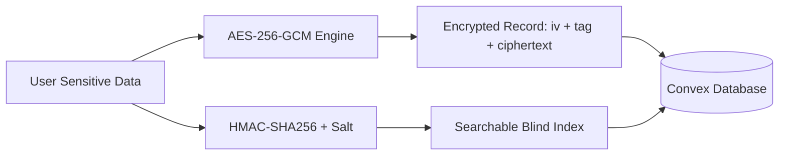

# Wekraft

<p align="center">
  
</p>

<p align="center">
  <strong>The All-in-One, AI-First Engineering & Project Management Platform</strong>
</p>

<p align="center">
  <a href="#key-features">Features</a> •
  <a href="#system-architecture">Architecture</a> •
  <a href="#tech-stack">Tech Stack</a> •
  <a href="#getting-started">Getting Started</a> •
  <a href="#environment-configuration">Environment</a> •
  <a href="#security--encryption">Security</a> •
  <a href="#contributing--license">License</a>
</p>

<p align="center">
  
  
  
  
  
  
  
  
</p>

---

## Overview

**Wekraft** is an enterprise-grade, real-time collaboration and project management SaaS platform engineered specifically for modern product teams and high-velocity engineering organizations.

Modern engineering teams suffer from severe context switching, juggling disparate tools: **Linear/Jira** for tickets, **Slack** for chat, **Zoom/Meet** for standups, **Miro/Draw.io** for architecture, **Zendesk** for customer requests, and standalone LLM apps for AI assistance. 

Wekraft unifies all these essential workflows into a single high-performance workspace powered by **reactive databases, edge messaging, and autonomous AI agents**.

---

## Key Features

### Agile Project & Task Management
- **Interactive Kanban Boards**: Fluid drag-and-drop task boards powered by `@dnd-kit` with column customization, sorting, tags, priorities, and status indicators.
- **Sprint Lifecycles**: Dedicated sprint planning, backlog management, milestones, and velocity tracking.
- **Subtasks & Comments**: Threaded task comments with markdown formatting, mentions, and file attachments.
- **Issue Tracking**: Dedicated issue lifecycle tracking with severity tagging, repro steps, and resolution workflows.

### Kaya — Autonomous AI Co-pilot
- **Context-Aware Assistance**: Deep integration into project tasks, issues, team meets, and documentation powered by LangChain and LangGraph.
- **Autonomous Tool Invocation**: Kaya can query database records, generate tasks, parse specifications, and summarize discussions.
- **Persistent Memory**: Retains contextual knowledge across sessions for seamless continuity.

### Teamspace & Real-Time Channels
- **High-Throughput Edge Messaging**: Instant channel and direct chat powered by **Ably Pub/Sub** and distributed **Turso (libSQL)** edge database.
- **Rich Messaging**: Threaded replies, emoji reactions, poll creation, and markdown formatting.
- **FTS5 Full-Text Search**: Instant search across extensive team conversation histories.

### In-App Video Standups & Meetings
- **Embedded Calling**: Multi-party, low-latency video and audio rooms integrated directly into workspaces using **Stream Video SDK**.
- **Deep-Linked Notifications**: Automated meeting alerts dispatched across channels with one-click joining.
- **Automated Lifecycle Management**: Stale meeting detection and scheduled cleanup crons.

### Visual Whiteboards & Architecture Diagrams
- **Interactive Whiteboard**: Canvas for brainstorming, wireframes, and diagrams powered by **React Flow (`@xyflow/react`)**.
- **Mermaid Graph Integration**: Render live flowcharts, sequence diagrams, and architecture maps directly from code or markdown.

### Customer Desk & Service Management
- **Customer Ticketing**: Manage external client requests, bugs, and feature queries within the same ecosystem.
- **Blind-Indexed Search**: Secure lookup of customer records without exposing raw personally identifiable information (PII).

### Unified Calendar, Heatmaps & Time Tracking
- **Project Calendar**: Synchronized calendar view of upcoming deadlines, sprints, and team milestones via **FullCalendar**.
- **Time Logging**: Granular work session tracking attached directly to tasks and sprints.
- **Activity Heatmap**: GitHub-style activity heatmaps visualizing team output and individual contributions.

### Enterprise Security & Audit Logging
- **Application-Level Encryption (ALE)**: Sensitive fields (task descriptions, issue details, customer data, and comments) are encrypted at rest using **AES-256-GCM**.
- **Tamper-Evident Audit Logs**: Comprehensive record of every create, update, delete, and permission change across the organization.

### Dynamic Location-Aware Billing
- **Intelligent Payment Routing**: Automatically detects user geolocation to route checkout:
  - **Domestic (India)**: Routed via **Razorpay** supporting UPI, NetBanking, and domestic cards in INR (₹).
  - **International**: Routed via **Stripe Checkout** supporting global cards in USD ($).
- **Subscription Lifecycle Management**: Webhooks sync status, handle grace periods, and execute automated tier management.

---

## System Architecture

Wekraft utilizes a distributed, serverless architecture that routes specialized workloads to optimized edge systems:

```mermaid
graph TD
    User([Next.js 16 Client / React 19]) -->|OAuth & Session| Clerk[Clerk Auth]
    User -->|Real-time Mutations & Queries| Convex[Convex Reactive DB]
    User -->|High-Throughput Messages| Ably[Ably Pub/Sub Router]
    User -->|Edge SQL & FTS5 Search| Turso[Turso / libSQL Edge DB]
    User -->|WebRTC Audio & Video| Stream[Stream Video SDK]
    User -->|File Storage| S3[AWS S3 Object Storage]

    subgraph Edge & API Layer
        API[/api/agent/] -->|Rate Limiting| Upstash[Upstash Redis]
        API -->|AI Pipeline| LangGraph[LangGraph + AI SDK]
        PayStripe[/api/payments/stripe] --> Stripe[Stripe API]
        PayRazor[/api/payments/razorpay] --> Razorpay[Razorpay API]
    end

    subgraph Background Workflows
        Convex -->|Scheduled Crons| Inngest[Inngest Workflow Engine]
        Inngest -->|Notifications| Convex
    end
```

### Hybrid Data Strategy

| Store | Technology | Responsibilities |
| :--- | :--- | :--- |
| **Operational Store** | **Convex** | Relational application state: Projects, Tasks, Sprints, Users, Permissions, Audit Logs, Customer Desk. |
| **Messaging Store** | **Turso (libSQL)** | High-throughput chat channels, message histories, reactions, and FTS5 full-text indexing. |
| **Realtime Pub/Sub** | **Ably** | Low-latency presence detection, live chat event broadcast, and meeting synchronization. |
| **Cache & Throttling** | **Upstash Redis** | Sliding-window API rate limiting, ghost request shields, and ephemeral token caching. |
| **Asset Storage** | **AWS S3 / Compatible** | User avatars, project document attachments, and media uploads. |

---

## Tech Stack

### Core Frameworks & Runtime
- **Framework**: [Next.js 16](https://nextjs.org/) (App Router, Server Actions, Turbopack)
- **Library**: [React 19](https://react.dev/)
- **Language**: [TypeScript 5](https://www.typescriptlang.org/)
- **Package Manager**: [pnpm](https://pnpm.io/)

### Styling & UI Components
- **CSS Engine**: [Tailwind CSS v4](https://tailwindcss.com/)
- **Component Primitives**: [Radix UI](https://www.radix-ui.com/) & [Base UI](https://base-ui.com/)
- **Icons**: [Lucide React](https://lucide.dev/) & [React Icons](https://react-icons.github.io/react-icons/)
- **Motion & Transitions**: [Framer Motion](https://www.framer.com/motion/) & [GSAP](https://greensock.com/)
- **Drag & Drop**: [`@dnd-kit`](https://dndkit.com/)
- **Visual Graphs**: [React Flow (`@xyflow/react`)](https://reactflow.dev/) & [Mermaid](https://mermaid.js.org/)
- **Toast Notifications**: [Sonner](https://sonner.emilkowal.ski/)

### Backend & Cloud Infrastructure
- **Reactive Cloud Database**: [Convex](https://www.convex.dev/)
- **Edge SQLite**: [Turso](https://turso.tech/) (`@libsql/client`)
- **Authentication**: [Clerk](https://clerk.com/)
- **Pub/Sub Messaging**: [Ably](https://ably.com/)
- **Video Calling**: [Stream Video SDK](https://getstream.io/video/) & [LiveKit](https://livekit.io/)
- **Caching & Rate Limiting**: [Upstash Redis](https://upstash.com/)
- **Background Jobs**: [Inngest](https://www.inngest.com/)
- **AI Engine**: [LangChain](https://www.langchain.com/), [LangGraph](https://langchain-ai.github.io/langgraphjs/), [Vercel AI SDK](https://sdk.vercel.ai/)
- **Payment Gateways**: [Stripe](https://stripe.com/) & [Razorpay](https://razorpay.com/)
- **Transactional Email**: [Resend](https://resend.com/) & [Nodemailer](https://nodemailer.com/)
- **Observability & Error Tracking**: [Sentry](https://sentry.io/)

---

## Repository Structure

```text
wekraft-prod/
├── convex/                     # Convex reactive backend
│   ├── _generated/             # Type-safe API bindings
│   ├── agentTools.ts           # Autonomous tools for Kaya AI
│   ├── auditLogs.ts            # Audit logging queries and mutations
│   ├── customerDesk.ts         # Customer ticketing & support desk
│   ├── http.ts                 # Webhook endpoints (Stripe, Razorpay, Clerk)
│   ├── projects.ts             # Workspace & project management
│   ├── schema.ts               # Database schema with ALE encryption
│   ├── tasks.ts                # Task board & sprint mutations
│   └── user.ts                 # User profile & subscription queries
├── Docs/                       # Engineering specifications & TRDs
│   ├── payment_integration.md  # Multi-gateway routing documentation
│   ├── production_audit.md     # Security & scaling performance audit
│   ├── TRD.md                  # Comprehensive Technical Requirements
│   └── version2.md             # Encryption & audit log specifications
├── public/                     # Static assets, branding, and icons
├── scripts/                    # Automation and build-time scripts
├── src/
│   ├── app/                    # Next.js App Router
│   │   ├── (admin)/            # Administrative control center
│   │   ├── (auth)/             # Clerk authentication flows
│   │   ├── (main)/             # Core authenticated application
│   │   │   └── dashboard/      # Project dashboards, workspace routes
│   │   │       ├── audit-logs/ # Audit log viewer
│   │   │       └── my-projects/[slug]/workspace/
│   │   │           ├── ai/             # Kaya AI chat interface
│   │   │           ├── calendar/       # Event & sprint calendar
│   │   │           ├── customer-desk/  # Support ticketing system
│   │   │           ├── flow-charts/    # Architecture flow builder
│   │   │           ├── heatmap/        # Team contribution heatmap
│   │   │           ├── issues/         # Bug & issue tracking
│   │   │           ├── meet/           # Video conference rooms
│   │   │           ├── sprint/         # Agile sprint manager
│   │   │           ├── tasks/          # Kanban task boards
│   │   │           ├── teamspace/      # Real-time team chat
│   │   │           ├── time-logs/      # Time tracking dashboard
│   │   │           └── whiteboard/     # Collaborative canvas
│   │   ├── (web)/              # Marketing landing pages & pricing
│   │   └── api/                # Edge & Serverless Next.js API routes
│   ├── components/             # Reusable UI component library (shadcn/ui)
│   ├── hooks/                  # Custom React hooks
│   ├── lib/                    # Shared utilities, crypto, and API clients
│   ├── modules/                # Domain-driven feature modules
│   └── store/                  # Client state stores (Zustand)
├── .env.example                # Canonical environment template
├── biome.json                  # Biome code formatting & linting config
├── next.config.ts              # Next.js build configuration
└── package.json                # Dependencies and project scripts
```

---

## Getting Started

### Prerequisites

Ensure you have the following installed on your machine:
- **Node.js**: `v20.x` or higher
- **pnpm**: `v9.x` or higher (`npm install -g pnpm`)
- **Git**

### Installation

1. **Clone the repository**:
   ```bash
   git clone https://github.com/ritesh-sinha29/wekraft-prod.git
   cd wekraft-prod
   ```

2. **Install dependencies**:
   ```bash
   pnpm install
   ```

3. **Configure Environment Variables**:
   Copy `.env.example` to `.env.local`:
   ```bash
   cp .env.example .env.local
   ```
   *(Fill in your respective API keys as described in the [Environment Reference](#environment-configuration) below).*

4. **Initialize the Convex Backend**:
   Run the Convex development daemon in a separate terminal:
   ```bash
   pnpm dlx convex dev
   ```
   *This connects to your Convex deployment and generates type-safe schemas under `convex/_generated`.*

5. **Start the Next.js Development Server**:
   ```bash
   pnpm dev
   ```

6. **Open your browser**:
   Navigate to [http://localhost:3000](http://localhost:3000) to view the application.

---

## Environment Configuration

Below is the reference guide for variables defined in [`.env.example`](file:///e:/Users/Ritesh%20Sinha/Desktop/PROJECTS/wekraft-prod/.env.example):

| Variable | Required | Description |
| :--- | :---: | :--- |
| `NEXT_PUBLIC_APP_URL` | Yes | Root web application URL (e.g. `http://localhost:3000` or production domain). |
| `NEXT_PUBLIC_AGENT_URL` | Optional | Endpoint for external Kaya AI agent worker services. |
| `NEXT_PUBLIC_CLERK_PUBLISHABLE_KEY` | Yes | Clerk publishable frontend key. |
| `CLERK_SECRET_KEY` | Yes | Clerk private backend secret key. |
| `CLERK_JWT_ISSUER_DOMAIN` | Yes | Clerk JWT domain configured in Convex Auth provider. |
| `CONVEX_DEPLOYMENT` | Yes | Convex deployment identifier (generated by `convex dev`). |
| `NEXT_PUBLIC_CONVEX_URL` | Yes | Public URL for client-side Convex reactive connection. |
| `TURSO_DATABASE_URL` | Yes | LibSQL database URL for edge messaging storage. |
| `TURSO_AUTH_TOKEN` | Yes | Authentication token for Turso database access. |
| `UPSTASH_REDIS_REST_URL` | Yes | Upstash Redis endpoint for API rate limiting. |
| `UPSTASH_REDIS_REST_TOKEN` | Yes | Upstash Redis REST credential. |
| `AWS_ACCES_KEY` | Yes | S3-compatible Access Key ID for attachment storage. |
| `AWS_SECRET_KEY_S3` | Yes | S3-compatible Secret Access Key. |
| `OPENAI_API_KEY` | Yes | OpenAI API key powering Kaya agentic reasoning. |
| `ABLY_API_KEY` | Yes | Ably API credential for real-time pub/sub channels. |
| `STREAM_API_KEY` | Yes | Stream Video SDK API key for in-app calling. |
| `STREAM_API_SECRET` | Yes | Stream Video SDK private secret key. |
| `NEXT_PUBLIC_RAZORPAY_KEY_ID` | Optional | Razorpay publishable Key ID for Indian domestic checkouts. |
| `RAZORPAY_KEY_SECRET` | Optional | Razorpay secret key for signature verification. |
| `RAZORPAY_WEBHOOK_SECRET` | Optional | Razorpay webhook verification token. |
| `LEMONSQUEEZY_API_KEY` | Optional | Lemon Squeezy API key (alternative gateway). |
| `BACKEND_SECRET` | Yes | High-entropy 64-character secret for internal API authorization. |
| `DB_ENCRYPTION_KEY` | Yes | 32-byte hexadecimal key for AES-256-GCM data encryption. |
| `BLIND_INDEX_SALT` | Yes | Cryptographic salt used to compute blind indexes on encrypted PII. |
| `SENTRY_AUTH_TOKEN` | Optional | Token for uploading source maps to Sentry on production builds. |

---

## Security & Encryption

Wekraft enforces a defense-in-depth security model:



1. **Application-Level Encryption (ALE)**:
   - Data is encrypted on the application server *before* reaching the persistent database.
   - Utilizes industry-standard **AES-256-GCM** with unique initialization vectors (`iv`) and authentication tags (`tag`) per field.
   - Encrypted entities include: `tasks.description`, `taskComments.comment`, `issues.description`, `issueComments.comment`, and customer contact data.
2. **Blind Indexing**:
   - Enables exact-match search queries across encrypted fields (such as customer emails) without decrypting records or leaking plaintext data to the database index.
3. **Tamper-Evident Audit Logging**:
   - Centralized audit stream recording actor, action type, resource ID, timestamp, and IP context across critical operational mutations.

---

## Available Scripts

Run these scripts from the project root:

| Command | Action |
| :--- | :--- |
| `pnpm dev` | Starts the Next.js local development server on port 3000. |
| `pnpm build` | Compiles documentation catalog, deploys Convex schemas, and builds the Next.js production bundle. |
| `pnpm start` | Launches the production Next.js server. |
| `pnpm lint` | Runs [Biome](https://biomejs.dev/) to check syntax, formatting, and linting errors. |
| `pnpm format` | Formats the codebase automatically according to Biome rules. |

---

## Contributing & License

Contributions are welcome! Please follow these guidelines:
1. Fork the repository and create your feature branch: `git checkout -b feature/amazing-feature`.
2. Ensure all changes adhere to Biome formatting: `pnpm format && pnpm lint`.
3. Commit your changes with descriptive messages: `git commit -m "feat: add amazing feature"`.
4. Push to your branch and open a Pull Request.

Distributed under the **Apache-2.0 License**. See [`LICENSE`](file:///e:/Users/Ritesh%20Sinha/Desktop/PROJECTS/wekraft-prod/LICENSE) for more information.

---

<p align="center">
  Crafted with care by <strong>Team Rox</strong>.
</p>

<p align="center">
  <a href="#key-features">Features</a> •
  <a href="#system-architecture">Architecture</a> •
  <a href="#tech-stack">Tech Stack</a> •
  <a href="#getting-started">Getting Started</a> •
  <a href="#environment-configuration">Environment</a> •
  <a href="#security--encryption">Security</a> •
  <a href="#contributing--license">License</a>
</p>

<p align="center">
  
  
  
  
  
  
  
  
</p>

---

## Overview

**Wekraft** is an enterprise-grade, real-time collaboration and project management SaaS platform engineered specifically for modern product teams and high-velocity engineering organizations.

Modern engineering teams suffer from severe context switching, juggling disparate tools: **Linear/Jira** for tickets, **Slack** for chat, **Zoom/Meet** for standups, **Miro/Draw.io** for architecture, **Zendesk** for customer requests, and standalone LLM apps for AI assistance. 

Wekraft unifies all these essential workflows into a single high-performance workspace powered by **reactive databases, edge messaging, and autonomous AI agents**.

---

## Key Features

### Agile Project & Task Management
- **Interactive Kanban Boards**: Fluid drag-and-drop task boards powered by `@dnd-kit` with column customization, sorting, tags, priorities, and status indicators.
- **Sprint Lifecycles**: Dedicated sprint planning, backlog management, milestones, and velocity tracking.
- **Subtasks & Comments**: Threaded task comments with markdown formatting, mentions, and file attachments.
- **Issue Tracking**: Dedicated issue lifecycle tracking with severity tagging, repro steps, and resolution workflows.

### Kaya — Autonomous AI Co-pilot
- **Context-Aware Assistance**: Deep integration into project tasks, issues, team meets, and documentation powered by LangChain and LangGraph.
- **Autonomous Tool Invocation**: Kaya can query database records, generate tasks, parse specifications, and summarize discussions.
- **Persistent Memory**: Retains contextual knowledge across sessions for seamless continuity.

### Teamspace & Real-Time Channels
- **High-Throughput Edge Messaging**: Instant channel and direct chat powered by **Ably Pub/Sub** and distributed **Turso (libSQL)** edge database.
- **Rich Messaging**: Threaded replies, emoji reactions, poll creation, and markdown formatting.
- **FTS5 Full-Text Search**: Instant search across extensive team conversation histories.

### In-App Video Standups & Meetings
- **Embedded Calling**: Multi-party, low-latency video and audio rooms integrated directly into workspaces using **Stream Video SDK**.
- **Deep-Linked Notifications**: Automated meeting alerts dispatched across channels with one-click joining.
- **Automated Lifecycle Management**: Stale meeting detection and scheduled cleanup crons.

### Visual Whiteboards & Architecture Diagrams
- **Interactive Whiteboard**: Canvas for brainstorming, wireframes, and diagrams powered by **React Flow (`@xyflow/react`)**.
- **Mermaid Graph Integration**: Render live flowcharts, sequence diagrams, and architecture maps directly from code or markdown.

### Customer Desk & Service Management
- **Customer Ticketing**: Manage external client requests, bugs, and feature queries within the same ecosystem.
- **Blind-Indexed Search**: Secure lookup of customer records without exposing raw personally identifiable information (PII).

### Unified Calendar, Heatmaps & Time Tracking
- **Project Calendar**: Synchronized calendar view of upcoming deadlines, sprints, and team milestones via **FullCalendar**.
- **Time Logging**: Granular work session tracking attached directly to tasks and sprints.
- **Activity Heatmap**: GitHub-style activity heatmaps visualizing team output and individual contributions.

### Enterprise Security & Audit Logging
- **Application-Level Encryption (ALE)**: Sensitive fields (task descriptions, issue details, customer data, and comments) are encrypted at rest using **AES-256-GCM**.
- **Tamper-Evident Audit Logs**: Comprehensive record of every create, update, delete, and permission change across the organization.

### Dynamic Location-Aware Billing
- **Intelligent Payment Routing**: Automatically detects user geolocation to route checkout:
  - **Domestic (India)**: Routed via **Razorpay** supporting UPI, NetBanking, and domestic cards in INR (₹).
  - **International**: Routed via **Stripe Checkout** supporting global cards in USD ($).
- **Subscription Lifecycle Management**: Webhooks sync status, handle grace periods, and execute automated tier management.

---

## System Architecture

Wekraft utilizes a distributed, serverless architecture that routes specialized workloads to optimized edge systems:

```mermaid
graph TD
    User([Next.js 16 Client / React 19]) -->|OAuth & Session| Clerk[Clerk Auth]
    User -->|Real-time Mutations & Queries| Convex[Convex Reactive DB]
    User -->|High-Throughput Messages| Ably[Ably Pub/Sub Router]
    User -->|Edge SQL & FTS5 Search| Turso[Turso / libSQL Edge DB]
    User -->|WebRTC Audio & Video| Stream[Stream Video SDK]
    User -->|File Storage| S3[AWS S3 Object Storage]

    subgraph Edge & API Layer
        API[/api/agent/] -->|Rate Limiting| Upstash[Upstash Redis]
        API -->|AI Pipeline| LangGraph[LangGraph + AI SDK]
        PayStripe[/api/payments/stripe] --> Stripe[Stripe API]
        PayRazor[/api/payments/razorpay] --> Razorpay[Razorpay API]
    end

    subgraph Background Workflows
        Convex -->|Scheduled Crons| Inngest[Inngest Workflow Engine]
        Inngest -->|Notifications| Convex
    end
```

### Hybrid Data Strategy

| Store | Technology | Responsibilities |
| :--- | :--- | :--- |
| **Operational Store** | **Convex** | Relational application state: Projects, Tasks, Sprints, Users, Permissions, Audit Logs, Customer Desk. |
| **Messaging Store** | **Turso (libSQL)** | High-throughput chat channels, message histories, reactions, and FTS5 full-text indexing. |
| **Realtime Pub/Sub** | **Ably** | Low-latency presence detection, live chat event broadcast, and meeting synchronization. |
| **Cache & Throttling** | **Upstash Redis** | Sliding-window API rate limiting, ghost request shields, and ephemeral token caching. |
| **Asset Storage** | **AWS S3 / Compatible** | User avatars, project document attachments, and media uploads. |

---

## Tech Stack

### Core Frameworks & Runtime
- **Framework**: [Next.js 16](https://nextjs.org/) (App Router, Server Actions, Turbopack)
- **Library**: [React 19](https://react.dev/)
- **Language**: [TypeScript 5](https://www.typescriptlang.org/)
- **Package Manager**: [pnpm](https://pnpm.io/)

### Styling & UI Components
- **CSS Engine**: [Tailwind CSS v4](https://tailwindcss.com/)
- **Component Primitives**: [Radix UI](https://www.radix-ui.com/) & [Base UI](https://base-ui.com/)
- **Icons**: [Lucide React](https://lucide.dev/) & [React Icons](https://react-icons.github.io/react-icons/)
- **Motion & Transitions**: [Framer Motion](https://www.framer.com/motion/) & [GSAP](https://greensock.com/)
- **Drag & Drop**: [`@dnd-kit`](https://dndkit.com/)
- **Visual Graphs**: [React Flow (`@xyflow/react`)](https://reactflow.dev/) & [Mermaid](https://mermaid.js.org/)
- **Toast Notifications**: [Sonner](https://sonner.emilkowal.ski/)

### Backend & Cloud Infrastructure
- **Reactive Cloud Database**: [Convex](https://www.convex.dev/)
- **Edge SQLite**: [Turso](https://turso.tech/) (`@libsql/client`)
- **Authentication**: [Clerk](https://clerk.com/)
- **Pub/Sub Messaging**: [Ably](https://ably.com/)
- **Video Calling**: [Stream Video SDK](https://getstream.io/video/) & [LiveKit](https://livekit.io/)
- **Caching & Rate Limiting**: [Upstash Redis](https://upstash.com/)
- **Background Jobs**: [Inngest](https://www.inngest.com/)
- **AI Engine**: [LangChain](https://www.langchain.com/), [LangGraph](https://langchain-ai.github.io/langgraphjs/), [Vercel AI SDK](https://sdk.vercel.ai/)
- **Payment Gateways**: [Stripe](https://stripe.com/) & [Razorpay](https://razorpay.com/)
- **Transactional Email**: [Resend](https://resend.com/) & [Nodemailer](https://nodemailer.com/)
- **Observability & Error Tracking**: [Sentry](https://sentry.io/)

---

## Repository Structure

```text
wekraft-prod/
├── convex/                     # Convex reactive backend
│   ├── _generated/             # Type-safe API bindings
│   ├── agentTools.ts           # Autonomous tools for Kaya AI
│   ├── auditLogs.ts            # Audit logging queries and mutations
│   ├── customerDesk.ts         # Customer ticketing & support desk
│   ├── http.ts                 # Webhook endpoints (Stripe, Razorpay, Clerk)
│   ├── projects.ts             # Workspace & project management
│   ├── schema.ts               # Database schema with ALE encryption
│   ├── tasks.ts                # Task board & sprint mutations
│   └── user.ts                 # User profile & subscription queries
├── Docs/                       # Engineering specifications & TRDs
│   ├── payment_integration.md  # Multi-gateway routing documentation
│   ├── production_audit.md     # Security & scaling performance audit
│   ├── TRD.md                  # Comprehensive Technical Requirements
│   └── version2.md             # Encryption & audit log specifications
├── public/                     # Static assets, branding, and icons
├── scripts/                    # Automation and build-time scripts
├── src/
│   ├── app/                    # Next.js App Router
│   │   ├── (admin)/            # Administrative control center
│   │   ├── (auth)/             # Clerk authentication flows
│   │   ├── (main)/             # Core authenticated application
│   │   │   └── dashboard/      # Project dashboards, workspace routes
│   │   │       ├── audit-logs/ # Audit log viewer
│   │   │       └── my-projects/[slug]/workspace/
│   │   │           ├── ai/             # Kaya AI chat interface
│   │   │           ├── calendar/       # Event & sprint calendar
│   │   │           ├── customer-desk/  # Support ticketing system
│   │   │           ├── flow-charts/    # Architecture flow builder
│   │   │           ├── heatmap/        # Team contribution heatmap
│   │   │           ├── issues/         # Bug & issue tracking
│   │   │           ├── meet/           # Video conference rooms
│   │   │           ├── sprint/         # Agile sprint manager
│   │   │           ├── tasks/          # Kanban task boards
│   │   │           ├── teamspace/      # Real-time team chat
│   │   │           ├── time-logs/      # Time tracking dashboard
│   │   │           └── whiteboard/     # Collaborative canvas
│   │   ├── (web)/              # Marketing landing pages & pricing
│   │   └── api/                # Edge & Serverless Next.js API routes
│   ├── components/             # Reusable UI component library (shadcn/ui)
│   ├── hooks/                  # Custom React hooks
│   ├── lib/                    # Shared utilities, crypto, and API clients
│   ├── modules/                # Domain-driven feature modules
│   └── store/                  # Client state stores (Zustand)
├── .env.example                # Canonical environment template
├── biome.json                  # Biome code formatting & linting config
├── next.config.ts              # Next.js build configuration
└── package.json                # Dependencies and project scripts
```

---

## Getting Started

### Prerequisites

Ensure you have the following installed on your machine:
- **Node.js**: `v20.x` or higher
- **pnpm**: `v9.x` or higher (`npm install -g pnpm`)
- **Git**

### Installation

1. **Clone the repository**:
   ```bash
   git clone https://github.com/ritesh-sinha29/wekraft-prod.git
   cd wekraft-prod
   ```

2. **Install dependencies**:
   ```bash
   pnpm install
   ```

3. **Configure Environment Variables**:
   Copy `.env.example` to `.env.local`:
   ```bash
   cp .env.example .env.local
   ```
   *(Fill in your respective API keys as described in the [Environment Reference](#environment-configuration) below).*

4. **Initialize the Convex Backend**:
   Run the Convex development daemon in a separate terminal:
   ```bash
   pnpm dlx convex dev
   ```
   *This connects to your Convex deployment and generates type-safe schemas under `convex/_generated`.*

5. **Start the Next.js Development Server**:
   ```bash
   pnpm dev
   ```

6. **Open your browser**:
   Navigate to [http://localhost:3000](http://localhost:3000) to view the application.

---

## Environment Configuration

Below is the reference guide for variables defined in [`.env.example`](file:///e:/Users/Ritesh%20Sinha/Desktop/PROJECTS/wekraft-prod/.env.example):

| Variable | Required | Description |
| :--- | :---: | :--- |
| `NEXT_PUBLIC_APP_URL` | Yes | Root web application URL (e.g. `http://localhost:3000` or production domain). |
| `NEXT_PUBLIC_AGENT_URL` | Optional | Endpoint for external Kaya AI agent worker services. |
| `NEXT_PUBLIC_CLERK_PUBLISHABLE_KEY` | Yes | Clerk publishable frontend key. |
| `CLERK_SECRET_KEY` | Yes | Clerk private backend secret key. |
| `CLERK_JWT_ISSUER_DOMAIN` | Yes | Clerk JWT domain configured in Convex Auth provider. |
| `CONVEX_DEPLOYMENT` | Yes | Convex deployment identifier (generated by `convex dev`). |
| `NEXT_PUBLIC_CONVEX_URL` | Yes | Public URL for client-side Convex reactive connection. |
| `TURSO_DATABASE_URL` | Yes | LibSQL database URL for edge messaging storage. |
| `TURSO_AUTH_TOKEN` | Yes | Authentication token for Turso database access. |
| `UPSTASH_REDIS_REST_URL` | Yes | Upstash Redis endpoint for API rate limiting. |
| `UPSTASH_REDIS_REST_TOKEN` | Yes | Upstash Redis REST credential. |
| `AWS_ACCES_KEY` | Yes | S3-compatible Access Key ID for attachment storage. |
| `AWS_SECRET_KEY_S3` | Yes | S3-compatible Secret Access Key. |
| `OPENAI_API_KEY` | Yes | OpenAI API key powering Kaya agentic reasoning. |
| `ABLY_API_KEY` | Yes | Ably API credential for real-time pub/sub channels. |
| `STREAM_API_KEY` | Yes | Stream Video SDK API key for in-app calling. |
| `STREAM_API_SECRET` | Yes | Stream Video SDK private secret key. |
| `NEXT_PUBLIC_RAZORPAY_KEY_ID` | Optional | Razorpay publishable Key ID for Indian domestic checkouts. |
| `RAZORPAY_KEY_SECRET` | Optional | Razorpay secret key for signature verification. |
| `RAZORPAY_WEBHOOK_SECRET` | Optional | Razorpay webhook verification token. |
| `LEMONSQUEEZY_API_KEY` | Optional | Lemon Squeezy API key (alternative gateway). |
| `BACKEND_SECRET` | Yes | High-entropy 64-character secret for internal API authorization. |
| `DB_ENCRYPTION_KEY` | Yes | 32-byte hexadecimal key for AES-256-GCM data encryption. |
| `BLIND_INDEX_SALT` | Yes | Cryptographic salt used to compute blind indexes on encrypted PII. |
| `SENTRY_AUTH_TOKEN` | Optional | Token for uploading source maps to Sentry on production builds. |

---

## Security & Encryption

Wekraft enforces a defense-in-depth security model:


1. **Application-Level Encryption (ALE)**:
   - Data is encrypted on the application server *before* reaching the persistent database.
   - Utilizes industry-standard **AES-256-GCM** with unique initialization vectors (`iv`) and authentication tags (`tag`) per field.
   - Encrypted entities include: `tasks.description`, `taskComments.comment`, `issues.description`, `issueComments.comment`, and customer contact data.
2. **Blind Indexing**:
   - Enables exact-match search queries across encrypted fields (such as customer emails) without decrypting records or leaking plaintext data to the database index.
3. **Tamper-Evident Audit Logging**:
   - Centralized audit stream recording actor, action type, resource ID, timestamp, and IP context across critical operational mutations.

---

## Available Scripts

Run these scripts from the project root:

| Command | Action |
| :--- | :--- |
| `pnpm dev` | Starts the Next.js local development server on port 3000. |
| `pnpm build` | Compiles documentation catalog, deploys Convex schemas, and builds the Next.js production bundle. |
| `pnpm start` | Launches the production Next.js server. |
| `pnpm lint` | Runs [Biome](https://biomejs.dev/) to check syntax, formatting, and linting errors. |
| `pnpm format` | Formats the codebase automatically according to Biome rules. |

---

## Contributing & License

Contributions are welcome! Please follow these guidelines:
1. Fork the repository and create your feature branch: `git checkout -b feature/amazing-feature`.
2. Ensure all changes adhere to Biome formatting: `pnpm format && pnpm lint`.
3. Commit your changes with descriptive messages: `git commit -m "feat: add amazing feature"`.
4. Push to your branch and open a Pull Request.

Distributed under the **Apache-2.0 License**. See [`LICENSE`](file:///e:/Users/Ritesh%20Sinha/Desktop/PROJECTS/wekraft-prod/LICENSE) for more information.

---

<p align="center">
  Crafted with care by <strong>Team Rox</strong>.
</p>
